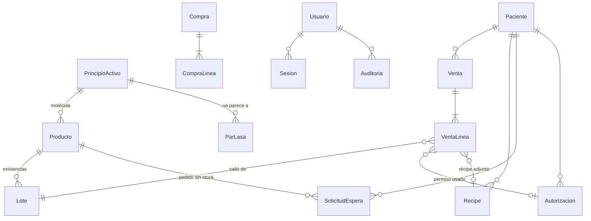
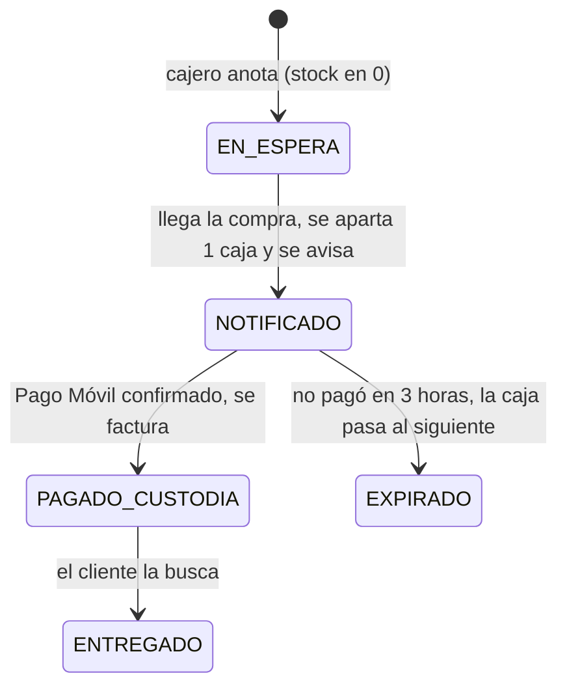

# Arquitectura

## Vista general

```mermaid
flowchart LR
  subgraph Equipos de la farmacia
    PC[PC de la caja<br/>lector de código de barras]
    TEL[Teléfono / tablet<br/>cámara para récipes]
  end
  subgraph VPS Contabo · Docker
    CADDY[Caddy<br/>HTTPS automático<br/>sirve la app web]
    API[API NestJS<br/>apps/api]
    DB[(PostgreSQL 16)]
    FOTOS[(Volumen privado<br/>fotos de récipes)]
  end
  WA[WhatsApp Business<br/>fase 3]
  IA[Proveedor de IA con visión<br/>fase 3]

  PC & TEL -- HTTPS --> CADDY
  CADDY -- /api/* --> API
  API --> DB
  API --> FOTOS
  API -. avisos .-> WA
  API -. lectura de récipes .-> IA
```

- **Una sola dirección (dominio)** para la app y la API: la app llama a `/api/v1/...` en el mismo origen, sin CORS en producción.
- **La base de datos no está expuesta a internet**: solo la API la ve, dentro de la red de Docker.
- **Las fotos de récipes** viven en un volumen privado y solo se entregan a usuarios con sesión.

## Tecnologías

| Parte | Elección | Por qué |
|---|---|---|
| App web | React 18 + Vite + TypeScript + Tailwind | Ya construida; una sola app para PC, tablet y teléfono |
| API | NestJS 10 + TypeScript | Mismo lenguaje que la app; estructura por módulos; guardias y validación centralizadas |
| Base de datos | PostgreSQL 16 + Prisma 5 | Transacciones y bloqueos por fila para el stock; migraciones versionadas |
| Reglas compartidas | `packages/shared` (Zod) | Las mismas validaciones en la app y en el servidor |
| Servidor web | Caddy 2 | Certificado HTTPS automático y cabeceras de seguridad |
| Despliegue | Docker Compose en VPS Contabo | Lo pedido en el documento; barato y reproducible |

## Estructura del repositorio

```
apps/
  web/                 App React (la demo de GitHub Pages sale de aquí)
  api/
    prisma/            Modelo de datos, migraciones y datos iniciales
    src/
      common/          Seguridad (guardia de acceso y roles), validación, errores
      auth/            Inicio de sesión, renovación y cierre de sesión
      usuarios/        Alta, baja y claves (solo dueño)
      catalogo/        Búsqueda de bioequivalentes, productos
      inventario/      Lotes FEFO, recepción de facturas de droguería
      ventas/          Venta con reglas clínicas y descuento de stock
      autorizaciones/  Permisos del Regente para productos delicados
      espera/          Lista de espera, reservas y vencimiento de reservas
      recipes/         Fotos de récipes, validación del Regente
      pacientes/       Ficha por cédula
      tasa/            Tasa del dólar
      reportes/        Resumen del dueño
      auditoria/       Registro de acciones sensibles
      notificaciones/  Canal de avisos (registro hoy, WhatsApp en fase 3)
    test/              Pruebas contra una base PostgreSQL real
packages/
  shared/              Enumeraciones, reglas y validaciones (Zod)
infra/                 Docker, Caddy, respaldos y preparación del servidor
docs/                  Esta documentación
```

## Modelo de datos

Basado en la sección 9 del documento de planificación, ampliado. Archivo: [`apps/api/prisma/schema.prisma`](../apps/api/prisma/schema.prisma).



Decisiones importantes:

- **Dinero**: `Decimal`, nunca números con coma flotante. Cada venta guarda la **tasa usada**: el monto en bolívares no cambia aunque la tasa cambie después.
- **Stock por lote** con `stockLibre` y `stockReservado` (documento, sección 2). La base de datos tiene una restricción que **impide stock negativo**.
- **Auditoría solo de escritura**: un disparador de PostgreSQL impide editar o borrar registros.

## Flujos clave

### Venta (`POST /api/v1/ventas`)

1. Valida los datos con el esquema compartido.
2. Aplica las reglas clínicas **en el servidor**:
   - Antibiótico, psicotrópico o producto que pide récipe → necesita cédula y récipe adjunto.
   - Antibiótico, psicotrópico o choque con una alergia del paciente → necesita una **autorización del Regente** vigente, para ese paciente y ese producto, que se usa una sola vez.
3. Bloquea los lotes del producto (`SELECT … FOR UPDATE`) y descuenta del que **vence primero** (FEFO), nunca de uno vencido.
4. Guarda la venta con la tasa del momento y registra la auditoría, todo en una sola transacción.

Si dos cajas venden la última unidad al mismo tiempo, una lo logra y la otra recibe «No hay suficiente». Está probado.

### Lista de espera (documento, sección 6)



- El orden es estricto: primero en anotarse, primero en recibir.
- Una tarea programada revisa cada 5 minutos las reservas vencidas.

### Récipes con IA (fase 3)

La foto se guarda y queda `PENDIENTE`. La lectura automática se conecta detrás de la interfaz `LectorRecipes` (`apps/api/src/recipes/recipes.ts`): la IA solo propone molécula, concentración y presentación, cruzadas con el catálogo. El semáforo (`semaforo()` en `packages/shared`) marca en rojo todo lo que está por debajo del 75 % o es un par LASA, y en ese caso **solo el Regente** decide.
