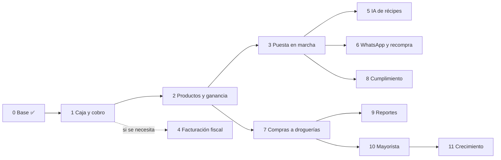

# Hoja de ruta

El sistema se construye **por etapas**: cada una termina con algo que la farmacia puede usar, probado de punta a punta, antes de empezar la siguiente. El orden importa: varias etapas dependen de las anteriores.

**Tamaño:** S = unos días · M = una a dos semanas · L = más de dos semanas (trabajando a tiempo parcial). Son estimaciones para planificar, no promesas al cliente.

## Resumen

| Etapa | Qué resuelve | Plan comercial | Tamaño | Estado |
|---|---|---|---|---|
| 0 · Base | Vender, clientes, récipes, permisos, encargos, inventario, Excel | Mostrador | — | ✅ Hecha |
| 1 · Caja y cobro | Cierre de caja, pagos mixtos, vuelto, devoluciones, ticket | Mostrador | M | Siguiente |
| 2 · Productos y ganancia | Productos desde la app, categorías, IVA, costo y margen, ajustes | Mostrador | M | Pendiente |
| 3 · Puesta en marcha | Instalar en la farmacia fundadora y capacitar | Mostrador | S | Pendiente |
| 4 · Facturación fiscal | Máquina fiscal o factura homologada (si la farmacia la necesita) | Extra | L | Por definir |
| 5 · IA de récipes | Leer la letra del médico con IA, medida con récipes reales | Completo | M | Pendiente |
| 6 · WhatsApp y recompra | Avisos automáticos, recordatorio de recompra, domicilio | Completo | M | Pendiente |
| 7 · Compras a droguerías | Proveedores, órdenes de compra, sugerido, cuentas por pagar | Mostrador | M | Pendiente |
| 8 · Cumplimiento | Libro de psicotrópicos, privacidad de datos de salud | Mostrador | S | Pendiente |
| 9 · Reportes | Ganancia, rotación, cajeros, cierres, exportar a Excel | Mostrador | M | Pendiente |
| 10 · Mayorista | Farmacia como proveedor: precios al mayor, crédito, pedidos, despacho | Mayorista | L | Pendiente |
| 11 · Crecimiento | Sucursales, portal de pedidos, multi-farmacia | Sucursales | L | Pendiente |

---

## Etapa 0 · Base ✅ hecha

- API completa con seguridad, 36 pruebas automáticas contra PostgreSQL real y CI en GitHub.
- App conectada: Vender (bioequivalentes, cliente por cédula, alergias, récipe, permiso al farmacéutico en vivo, cobro), Récipe, Por revisar, Clientes, Encargos, Inventario con compras y **carga desde Excel**, Resumen con tasa y Usuarios.
- Despliegue con Docker y HTTPS, respaldos cifrados, **modo compartido** para un VPS con otro proyecto.
- Demo pública con datos de ejemplo en GitHub Pages.

---

## Etapa 1 · Caja y cobro

**Objetivo:** que la caja cuadre al final del día y cobrar sea rápido, como en cualquier farmacia venezolana.

- [ ] **Apertura de caja:** el cajero abre su turno con un fondo inicial (en $ y en Bs).
- [ ] **Pagos mixtos:** una venta se paga con varios métodos (ej. 5 $ en efectivo + el resto por Pago Móvil).
- [ ] **Vuelto:** el sistema calcula el vuelto en Bs o en $ y lo registra.
- [ ] **Pantalla de cobro rápida:** teclado numérico, botones de billetes (1, 5, 10, 20 $) y «monto exacto».
- [ ] **Cierre de caja:** el cajero cuenta lo que tiene; el sistema muestra lo esperado por método de pago y la diferencia. El dueño ve y aprueba los cierres.
- [ ] **Devoluciones:** devolver toda o parte de una venta, con permiso del farmacéutico o del dueño, con motivo, y el stock vuelve a su lote.
- [ ] **Descuentos:** por línea o por venta (tercera edad, convenio), con permiso y en la auditoría.
- [ ] **Ticket:** comprobante para imprimir en impresora térmica o enviar en PDF (no fiscal).
- [ ] **Escáner con la cámara** del teléfono para códigos de barras.

**Listo cuando:** un cajero abre caja, hace ventas con pagos mixtos y vuelto, devuelve un producto y cierra, y la diferencia del cierre es cero cuando contó bien. Probado en el navegador y con pruebas automáticas.

**Preguntar al cliente:** ¿un cajero por caja o varios turnos en la misma caja? ¿Qué impresora de tickets usa? ¿Qué descuentos da hoy?

---

## Etapa 2 · Productos, precios y ganancia

**Objetivo:** que el dueño maneje su catálogo y sepa cuánto gana, sin depender del Excel.

- [ ] **Productos desde la app:** crear, editar, activar y desactivar.
- [ ] **Categorías:** medicamentos, cuidado personal, bebé, misceláneos (configurables).
- [ ] **IVA por producto** (exento o con alícuota) e **IGTF** configurable para pagos en divisas, reflejados en la venta y el ticket.
- [ ] **Costo:** se guarda en cada compra; el producto muestra costo, precio y **margen**.
- [ ] **Cambio de precios masivo:** por laboratorio, categoría o selección (ej. +5 %), con vista previa y en la auditoría.
- [ ] **Ajustes de inventario:** merma, roto, vencido y conteo físico, siempre con motivo.
- [ ] **Mínimos:** aviso de stock bajo en Inventario y en el Resumen.

**Listo cuando:** el dueño crea un producto con su categoría e IVA, carga una compra con costo, ve el margen, sube precios a un laboratorio y corrige el stock con un ajuste.

**Preguntar al cliente (y a su contador):** ¿qué productos llevan IVA y cuáles están exentos? ¿Cobra IGTF? ¿Cómo calcula hoy sus precios?

---

## Etapa 3 · Puesta en marcha en la farmacia fundadora

**Objetivo:** el sistema funcionando de verdad en la farmacia.

- [ ] Instalar en el VPS ([DESPLIEGUE.md](DESPLIEGUE.md), modo compartido si el VPS ya tiene otro proyecto).
- [ ] Respaldos diarios con copia fuera del VPS.
- [ ] Cargar el inventario real desde Excel y crear los usuarios.
- [ ] **Segundo factor (2FA)** para el dueño.
- [ ] **Aviso claro cuando se va el internet** y reintento automático.
- [ ] Monitoreo: aviso si el sistema deja de responder.
- [ ] Capacitación (2 horas) y dos semanas de acompañamiento.

**Listo cuando:** la farmacia vende una semana completa solo con el sistema y los cierres de caja cuadran.

---

## Etapa 4 · Facturación fiscal (solo si la farmacia la necesita)

**Objetivo:** cumplir con el SENIAT al vender.

- [ ] Integración con la **máquina fiscal** que tenga la farmacia, o con un proveedor de **factura digital homologado**.
- [ ] Notas de crédito fiscales para las devoluciones.
- [ ] **Libros de compras y ventas** para el contador.

**Preguntar al cliente:** ¿está obligado a usar máquina fiscal o factura digital? ¿Qué modelo o proveedor usa hoy? **Se cotiza aparte**: depende totalmente del equipo o proveedor.

---

## Etapa 5 · IA de récipes

**Objetivo:** que la app lea la letra del médico y proponga los medicamentos, sin decidir por el farmacéutico.

- [ ] Reunir **30 a 50 fotos de récipes reales** (sin datos del paciente) con la respuesta correcta.
- [ ] Implementar el lector (`LectorRecipes`) con un modelo de visión y salida estructurada.
- [ ] Cruce con el catálogo, pares LASA y semáforo (verde / amarillo / rojo).
- [ ] Medir aciertos y costo por récipe con Opus y con Haiku; elegir el modelo.
- [ ] Mostrar la lectura en Récipe y en Por revisar.

**Listo cuando:** sobre los récipes de prueba, el semáforo nunca marca verde una lectura equivocada, y el costo por récipe está medido.

**Necesito:** una clave de la API de Anthropic y las fotos.

---

## Etapa 6 · WhatsApp y recompra

**Objetivo:** vender más sin que el cliente tenga que venir a preguntar.

- [ ] Número de **WhatsApp Business** verificado y plantillas aprobadas por Meta.
- [ ] Aviso automático «llegó su medicamento» con precio y datos de Pago Móvil (lista de espera).
- [ ] **Recordatorio de recompra** para tratamientos continuos («tu losartán se termina en 3 días»).
- [ ] **Pedidos a domicilio** básicos: el pedido entra, se arma, se cobra y se marca enviado.

**Preguntar al cliente:** el número que usará (debe estar a su nombre) y si hace delivery hoy.

---

## Etapa 7 · Compras a droguerías

**Objetivo:** comprar mejor y saber cuánto se debe.

- [ ] Ficha de **droguerías** (proveedores) y qué productos trae cada una.
- [ ] **Sugerido de compra:** según ventas, existencia, mínimos y lo que pidieron y no había.
- [ ] **Órdenes de compra** y recepción comparando lo pedido con lo que llegó.
- [ ] **Cuentas por pagar:** facturas por droguería, vencimientos y pagos.
- [ ] **Devolución a droguería** de vencidos o dañados.

**Listo cuando:** el dueño genera un pedido desde el sugerido, lo recibe con diferencias y ve cuánto le debe a cada droguería.

---

## Etapa 8 · Cumplimiento

- [ ] **Libro de psicotrópicos y estupefacientes:** entradas y salidas con paciente, médico, récipe y farmacéutico, listo para imprimir.
- [ ] **Aviso de privacidad** al registrar clientes y **política de retención** de fotos de récipes (borrado automático pasado el plazo).

**Preguntar al regente:** el formato exacto que le exigen para el libro de controlados.

---

## Etapa 9 · Reportes

- [ ] Ganancia por producto, categoría y laboratorio.
- [ ] Rotación: lo que más se vende y lo que no se mueve.
- [ ] Ventas por cajero, por hora y por método de pago.
- [ ] Historial de cierres de caja con diferencias.
- [ ] **Exportar cualquier reporte a Excel.**

---

## Etapa 10 · Mayorista (la farmacia como proveedor)

**Objetivo:** que la farmacia venda al mayor a otras farmacias, clínicas y empresas.

- [ ] **Clientes empresa:** RIF, razón social, dirección fiscal, contacto, vendedor.
- [ ] **Listas de precios:** detal, mayor y convenio; el precio se elige según el cliente.
- [ ] Venta por **caja máster** a precio de mayor.
- [ ] **Cotizaciones y pedidos**, con stock apartado mientras se aprueban.
- [ ] **Nota de entrega y despacho:** preparado, despachado, entregado (con firma de recibido).
- [ ] **Crédito y cuentas por cobrar:** plazo, límite de crédito, abonos, estado de cuenta, aviso de facturas vencidas.
- [ ] **Convenios con empresas:** sus empleados compran y se le factura a la empresa.

**Listo cuando:** un cliente empresa recibe una cotización con precio de mayor, se convierte en pedido, se despacha a crédito, abona y su estado de cuenta cuadra.

---

## Etapa 11 · Crecimiento

- [ ] **Sucursales:** inventario por sucursal y traslados entre ellas.
- [ ] **Portal de pedidos** para clientes mayoristas (catálogo con su precio).
- [ ] Puntos o descuentos por cliente frecuente.
- [ ] Segunda pantalla para el cliente en la caja.
- [ ] **Multi-farmacia:** una sola instalación para todas tus farmacias clientes, con un panel tuyo de suscripciones y cobros ([NEGOCIO.md](NEGOCIO.md), sección 6).

---

## Cómo se trabaja cada etapa

1. **Antes:** confirmar con el cliente las preguntas de la etapa.
2. **Durante:** cambios en el servidor con pruebas automáticas, luego la pantalla, luego una prueba de punta a punta en el navegador.
3. **Al terminar:** actualizar esta hoja de ruta, la documentación de la API y las capturas en `docs/pantallas`, y subir a `main` con las pruebas en verde.
4. **Cobro:** si la etapa no estaba en lo acordado, se cotiza antes de empezarla.

## Lo que hay que definir con el cliente

| Tema | Etapa | Por qué importa |
|---|---|---|
| **Facturación fiscal (SENIAT)** | 4 | Si las ventas deben salir por máquina fiscal o factura homologada, cambia el cobro y es trabajo adicional |
| **IVA e IGTF por producto** | 2 | Define cómo se calculan el ticket y los reportes |
| **De dónde sale el inventario inicial** | 3 | Excel o exportación del sistema actual (Valery, Saint, A2…) |
| **Impresora de tickets** | 1 | Modelo y conexión (USB o red) |
| **Número de WhatsApp Business** | 6 | A nombre del cliente en Meta; la aprobación puede tardar días |
| **Banco del Pago Móvil** | 6 | Define si la confirmación puede ser automática |
| **Retención de fotos de récipes** | 8 | Son datos de salud |
| **¿Vende al mayor?** | 10 | Si la fundadora ya lo hace, la etapa 10 puede adelantarse |

## Costos y presupuesto

Los costos de servicios (VPS, dominio, respaldos, WhatsApp, IA) y la propuesta de precios están en [NEGOCIO.md](NEGOCIO.md).

Recomendación: que los 1.000 $ de la farmacia fundadora cubran las etapas **0 a 3, la 5 y la 6** (lo del documento original, más la caja y los productos, que hacen falta para operar). Las etapas **4 y 7 a 11** van más allá de lo acordado: se cotizan aparte o entran en planes más caros (Mayorista, Sucursales). Recordatorio: los 1.000 $ pagan la implementación y el uso, **no la propiedad del código**.
